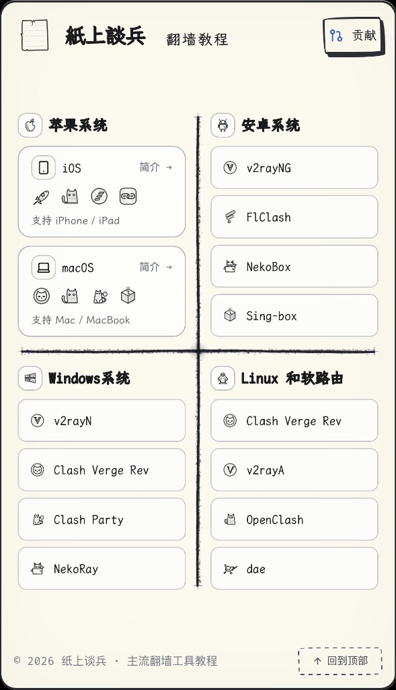
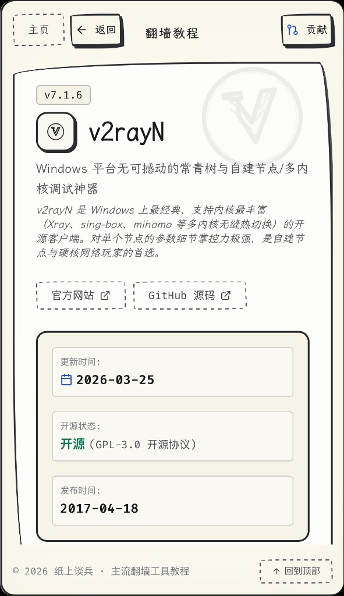
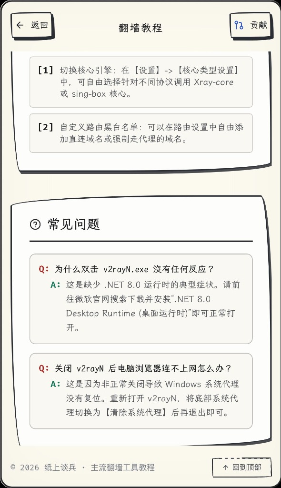

# 紙上談兵

> 全平台科学上网客户端图文教程库，GitHub 众包协作维护。

[](https://vite.dev)
[](https://react.dev)
[](https://www.typescriptlang.org)
[](https://tailwindcss.com)

<p align="center">
  
</p>
<p align="center">
  
  
  
</p>

---

## 收录清单

每个系统严格限额 **4 款**，只收录最常用、最具代表性的工具。

| 系统 | 收录软件 |
| :--- | :--- |
| **iOS** | Shadowrocket、Clash、Sing-box、Karing |
| **macOS** | Clash Verge Rev、Clash、Clash Party、Sing-box |
| **Android** | v2rayNG、FlClash、NekoBox、Sing-box |
| **Windows** | v2rayN、Clash Verge Rev、Clash Party、Sing-box |
| **Linux / 软路由** | Clash Verge Rev、v2rayA、OpenClash、自己搭建节点 |

---

## 本地开发

```bash
npm install
npm run dev    # 启动开发服务（热重载）
npm run build  # 生产构建
```

---

## DTMS 内容管理

### 入口与编辑范围

- 直接访问 `/dtms`，或在主站**空白区域 1.5 秒内连续点击 5 次**。按钮、链接、卡片和正文点击不会计入。
- 管理页沿用主站的纸张、铅笔边框、字体和按钮风格；打开后加载当前已发布内容，首次使用加载项目内置资源。
- 可编辑软件全称/简称、简介、版本、下载链接、规格、教程步骤、代码、提示、问答、前置条件及更新日志；支持数组增删和排序。
- 软件卡片顺序与首页四象限内按钮顺序分别管理，并支持 iOS/macOS 顺序、象限文案、站点名称/副标题、页脚文字和链接编辑。
- 软件 ID、系统归属与固定的 20 款软件清单保持不变，以保护现有 URL 和图标映射。界面结构与程序逻辑不属于内容资源。
- 点击顶部「应用」会校验当前编辑并保存为**此浏览器、当前站点的本地预览**，无需 PAT、GitHub 提交或线上部署。点击「返回主站」或教程旁的「查看本地预览」即可查看；同源新标签页和刷新后仍可读取已应用内容。后续修改需再次点击「应用」。
- 本地预览时主站顶部显示提示，可「继续编辑」或「退出本地预览」；退出后重新加载已部署内容。重新进入 CMS 会保留已应用内容并读取仓库 SHA，不会自动用仓库内容覆盖本地预览；主动「重新载入仓库」仍会替换编辑器内容。应用不会清除未提交状态，也不会改动 GitHub SHA，正式发布仍需提交并等待部署。
- 本地预览只保存在浏览器存储，不修改项目源文件或影响其他访客；已打开的其他标签页需刷新。清理浏览器数据会丢失预览，存储不可用或已满时会提示应用失败。可另行保存/恢复当前浏览器草稿，或导入/导出 JSON 备份；草稿与本地预览分别保存，均不是全站发布。
- 教程与 CMS 已移除手绘设备演示和资源占用字段；读取旧 GitHub 内容、静态 JSON、导入备份或恢复草稿时自动清理这两个旧字段，下次提交不再包含它们。其他未知或非法字段仍会拒绝载入。

### 纯静态托管与 GitHub 提交

参考 [不想翻墙 CMS](https://bxfq.sld.tw/dtms) 的仓库连接、SHA 版本和提交交互：CMS 随主站一起部署，**不需要单独的服务器、数据库、管理密钥环境变量或 `/api/content` 接口**。

1. 访问 `/dtms`，输入 GitHub Fine-grained PAT。只授权目标仓库的 **Contents: Read and write** 权限；PAT 对应账号也必须拥有仓库写权限。
2. 默认仓库 `kanpianer/zstb`、分支 `main`，Fork 部署时可在管理页更改所有者、仓库和分支。
3. 打开 CMS 后自动读取仓库最新内容与文件 SHA，公开仓库无需 PAT 即可载入，不需要手动连接。修改后可直接提交；提交仍需要填写 PAT。私有仓库或读取失败时，在「连接内容仓库」中填写 PAT 后点击「重新载入仓库」。载入成功前禁止提交，避免旧部署内容覆盖新提交。PAT 右侧的「测试有效性」只读验证，不创建提交或覆盖编辑。
4. 修改教程、排序或文案，填写提交说明，点击「提交到 GitHub」并确认。
5. 浏览器直接调用 GitHub Contents API，将完整内容写入 `public/content/site-content.json`，提交成功后显示 GitHub 提交链接及 Actions 链接。
6. 等待该分支绑定的静态托管平台完成构建与部署，再刷新主站。**GitHub 提交成功 ≠ 部署完成**。若该分支没有配置自动部署，需要在现有平台手动部署。

生产构建命令仍为 `npm run build`，输出目录仍为 `dist`。使用现有 Cloudflare Pages、Netlify 等 Git 集成静态托管即可，不需要新增 CMS 托管。构建会生成 `/dtms/index.html`，同时提供 `_redirects` 规则，支持直接访问管理路径。普通访客只读取已部署的 `/content/site-content.json`，不会调用 GitHub API。

初始内容文件为 `null`，表示使用当前项目内置教程；首次 CMS 提交后成为完整内容 JSON，并作为站点的内容来源。后续直接修改原 TypeScript 教程不会覆盖 JSON 内容，应在 CMS 修改或同步更新此 JSON。CMS 不改写原始教程 TypeScript/Markdown 文件。构建阶段校验 JSON，非法结构会阻止发布。Git 历史可用来备份和回滚内容。

PAT **只保存在当前管理页内存**，不保存在 localStorage、草稿、导出文件或仓库中，只通过 Authorization 头发送至 `api.github.com`。关闭或刷新管理页后需要重新输入。隐藏入口不替代权限认证；请通过 HTTPS 使用，并只在可信设备上输入 PAT。

提交使用读取时的文件 SHA；他人已更新时提示冲突，不自动重试或强行覆盖。请先导出当前修改，再重新载入合并。权限不足、令牌失效、API 限流、受保护分支等错误会明确显示。受保护分支请改用允许写入的内容分支，再在 GitHub 合并到部署分支。

```bash
npm run dev    # 本地开发；无需配套后端
npm test       # 内容模型、五连击、GitHub Contents API 模拟回归
npm run build  # 内容校验、TypeScript 检查及静态打包
npm run preview # 本地预览构建产物
```

真实浏览器回归可运行 `node scripts/check-cms-browser.mjs`（需要本机 Chromium 及 Node.js 22+）；使用 DevTools 模拟 GitHub 响应，不访问或修改真实仓库。

---

## 参与贡献

- **提 Issue**：反馈教程错误或请求更新，维护者会跟进；
- **发 PR**：Fork 后修改对应教程文件（`src/data/tutorials/<系统>/<工具>.ts`），`npm run build` 通过后提交。
