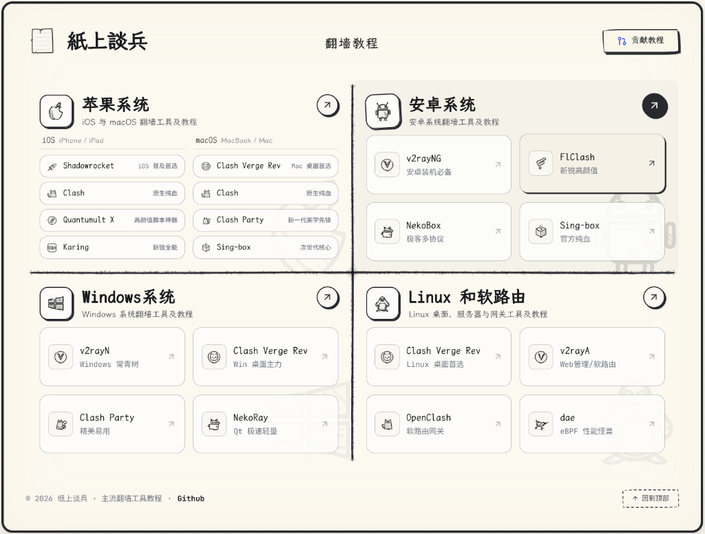
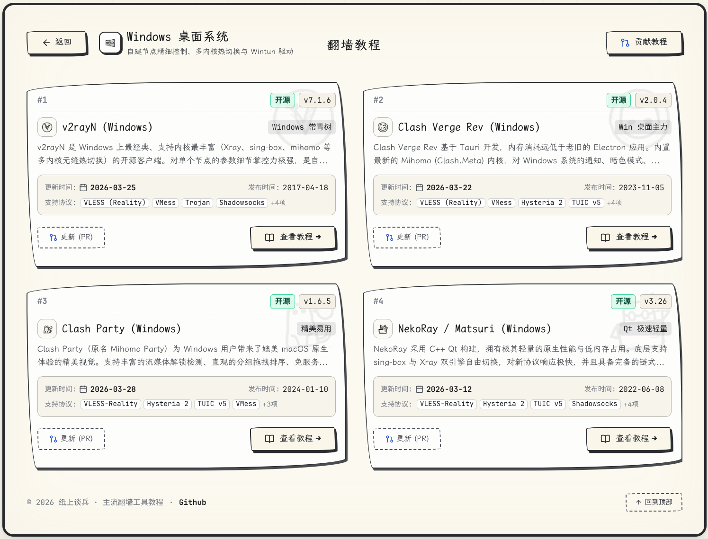
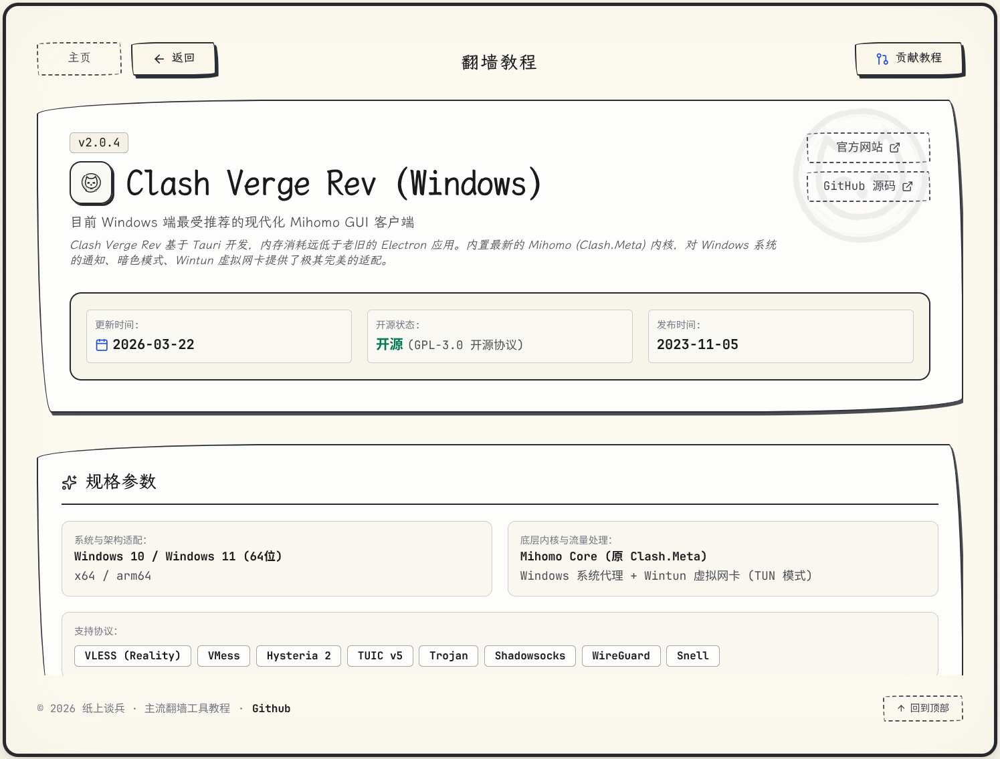
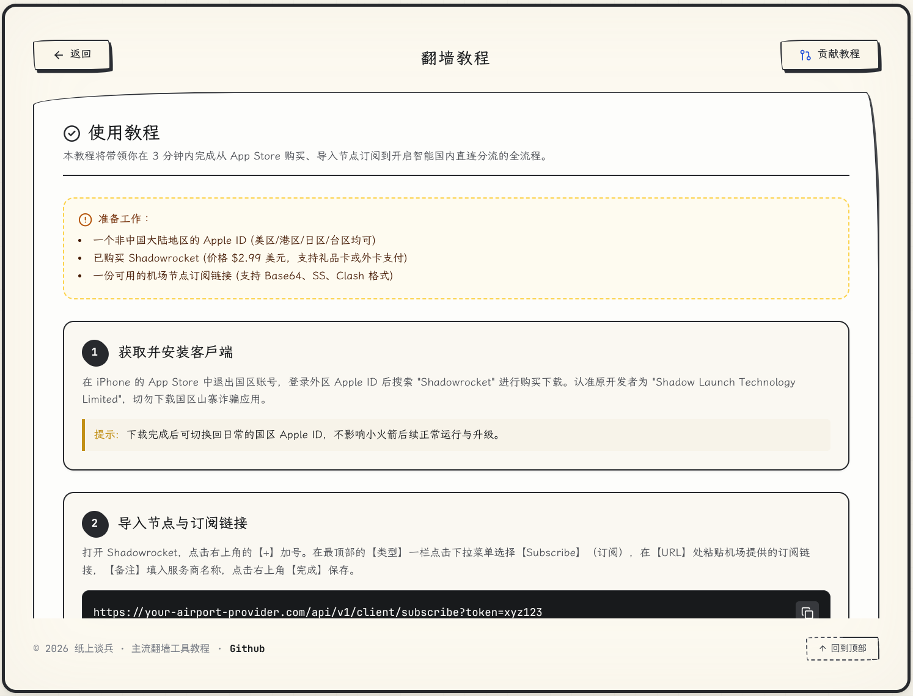

# 紙上談兵

> 全平台科学上网客户端图文教程库，GitHub 众包协作维护。

[](https://vite.dev)
[](https://react.dev)
[](https://www.typescriptlang.org)
[](https://tailwindcss.com)

<p align="center">
  
  
</p>
<p align="center">
  
  
</p>

---

## 收录清单

每个系统严格限额 **4 款**，只收录最常用、最具代表性的工具。

| 系统 | 收录软件 |
| :--- | :--- |
| **iOS** | Shadowrocket、Clash、Quantumult X、Karing |
| **macOS** | Clash Verge Rev、Clash、Clash Party、Sing-box |
| **Android** | v2rayNG、FlClash、NekoBox、Sing-box |
| **Windows** | v2rayN、Clash Verge Rev、Clash Party、NekoRay |
| **Linux / 软路由** | Clash Verge Rev、v2rayA、OpenClash、dae |

---

## 本地开发

```bash
npm install
npm run dev    # 启动开发服务（热重载）
npm run build  # 生产构建
```

---

## 参与贡献

- **提 Issue**：反馈教程错误或请求更新，维护者会跟进；
- **发 PR**：Fork 后修改对应教程文件（`src/data/tutorials/<系统>/<工具>.ts`），`npm run build` 通过后提交。
